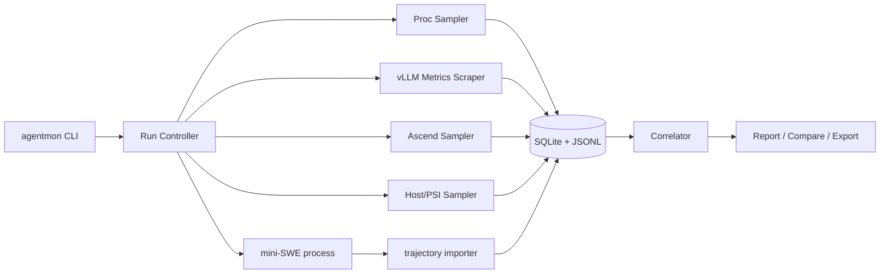

# AgentMon：Coding Agent 全栈负载观测工具技术规格

**文档版本**：1.0  
**基线日期**：2026-07-01  
**目标读者**：负责从零实现该工具的 Codex / 软件工程师  
**实现目标**：在无 root、离线、ARM64 Linux 环境中，对 mini-SWE-agent + LiteLLM + vLLM-Ascend + Qwen3-Coder 的端到端运行负载进行低开销、可追溯、可降级的实时监控与离线分析。

---

## 0. 文档用途与强制约束

本文件是实现规格，不是概念性建议。实现者应将其视为需求基线、架构说明、数据契约和验收标准的组合。

### 0.1 已确认运行环境

| 项目 | 值 |
|---|---|
| 主机名 | `DevServer-BMS-3d97cc99-0` |
| OS / 架构 | Linux / `aarch64` |
| 内核 | `5.15.0-91-generic` |
| 用户 | `chenyang`，普通用户，无管理员权限 |
| 系统 Python | `/usr/bin/python3`，3.10.12 |
| 数据根目录 | `/data/node0_disk3/chenyang` |
| CANN | 9.0.0，`/usr/local/Ascend/cann-9.0.0` |
| 推理环境 Python | `/data/node0_disk3/chenyang/agent-runtime-poc/envs/verl-cann90/bin/python`，Python 3.11 |
| vLLM | `0.18.0+empty` |
| vLLM-Ascend | `0.18.0` |
| 模型 | Qwen3-Coder-30B-A3B-Instruct，BF16 |
| 模型目录 | `/data/node0_disk3/chenyang/qwen3_coder_30b` |
| 服务模型名 | `qwen3-coder-30b` |
| OpenAI API | `http://127.0.0.1:8000/v1` |
| Prometheus metrics | `http://127.0.0.1:8000/metrics` |
| 并行配置 | TP=4，EP 开启，`mp` executor |
| vLLM 限制 | max model len=8192，max seqs=4，max batched tokens=8192 |
| 内存配置 | `gpu-memory-utilization=0.90` |
| 执行模式 | Eager |
| Prefix Cache | 关闭，`--no-enable-prefix-caching` |
| Agent | mini-SWE-agent 2.4.3 |
| Agent Python | `/data/node0_disk3/chenyang/agent-runtime-poc/envs/mini-swe-v243/bin/python` |
| Agent 根目录 | `/data/node0_disk3/chenyang/agent-runtime-poc/mini-swe` |
| trajectory | `$MINI_SWE_ROOT/trajectories/*.traj.json` |
| 网络 | 服务器不能联网 |

### 0.2 不可违反的工程约束

1. **P0 不要求 root，不要求 Docker，不要求联网。**
2. **P0 默认只使用 Python 标准库。** 可选依赖必须不是必需路径。
3. **不得修改系统 CANN、驱动或正在运行的 vLLM 环境。**
4. **不得默认重启 vLLM 服务。**
5. **不得默认打开 Prefix Cache、Profiler 或改变推理参数。**
6. **任何不可获得的指标必须输出 `unavailable`、`disabled` 或 `unsupported`，不得伪造为 0。**
7. **采集器崩溃不得终止被监控的 Agent；Agent 退出后采集器必须完成数据落盘。**
8. **所有实现必须支持 capability discovery，禁止把单一 `npu-smi` 输出格式或单一 vLLM 指标名写死。**
9. **原始数据必须保留，以便未来重新计算。**
10. **所有阶段均应先完成测试和验收，再进入下一阶段。**

---

## 1. 项目目标、非目标与成功定义

## 1.1 总体目标

构建命令行工具 `agentmon`，能够：

```bash
agentmon doctor
agentmon run -- <mini-swe command>
agentmon live <run-id>
agentmon report <run-id>
agentmon compare <run-id-a> <run-id-b>
agentmon import-trajectory <path.traj.json>
agentmon export <run-id> --format json|csv
```

完成以下观测闭环：

```text
任务边界
  ├─ mini-SWE Agent 轮次与工具调用
  ├─ LiteLLM / vLLM 模型请求
  ├─ Agent 与工具进程树 CPU / 内存 / I/O
  ├─ vLLM 排队、Prefill、Decode、Token 与 KV Cache
  ├─ 4 张 Ascend NPU 的利用率、HBM、功率、温度
  └─ 跨来源时间对齐、归因、汇总与比较
```

## 1.2 非目标

以下不作为 P0/P1 的强制目标：

- 替代 Prometheus、Grafana 或完整 APM 平台；
- 修改 Linux 内核、安装 eBPF 程序；
- 对所有 Ascend 产品和所有 CANN 版本提供完美解析；
- 在 P0 中实现算子级追踪；
- 在 P0 中精确归属每个模型请求的 NPU 能耗；
- 在 P0 中精确追踪每个 KV Block 的分配与驱逐；
- 自动调优 vLLM 参数；
- 自动修改模型服务配置；
- 收集完整 Prompt、源码或 Shell 输出作为默认行为。

## 1.3 成功定义

P0 成功的最低标准：

- 能在目标服务器普通用户下运行；
- 能包装一次 mini-SWE-agent 任务；
- 任务退出码原样返回；
- 生成完整的 run 目录；
- 成功抓取 `/metrics` 或明确报告失败原因；
- 成功采集 Agent 进程树资源；
- 成功采集至少 HBM 和 AICore 中的一项 NPU 指标，或保留原始 `npu-smi` 输出并标记解析失败；
- 可导入 `.traj.json` 并给出轮次、API 调用、工具调用、退出状态；
- 报告中所有数值都可追溯到原始事件或采样点。

P1 成功的最低标准：

- 每个模型请求和工具调用都有唯一 ID、单调时钟起止时间；
- 每个工具调用至少关联根 PID/PGID；
- 可以计算工具级 CPU core-seconds、峰值 PSS、I/O；
- Agent 轨迹中保留观测 metadata，但不改变 Agent 行为。

P2 成功的最低标准：

- request ID 能从 Agent 透传到 vLLM 侧或通过稳定映射关联；
- 可以输出请求级 cached/computed token、Prefill/Decode 时间；
- 能区分 KV Cache 关闭、无命中、被驱逐和重计算；
- 插件与 vLLM 0.18.0 明确版本绑定，失败时不影响服务。

P3 成功的最低标准：

- 能按需启动和停止 vLLM Ascend Profiler；
- 只对指定短窗口采集；
- 生成原始 profiler 目录和可读摘要；
- Profiler 不可用时正常降级。

---

## 2. 术语和时间模型

## 2.1 核心术语

- **Run**：一次完整 Agent 任务，由 `agentmon run` 创建。
- **Span**：具有开始和结束时间的活动，例如模型请求、工具调用、测试、任务。
- **Sample**：某个时刻的资源状态，例如 NPU 利用率或进程 RSS。
- **Counter**：只递增的累计值，例如 vLLM prompt tokens。
- **Gauge**：瞬时值，例如 KV 使用率。
- **Histogram**：Prometheus 桶式累计分布。
- **Raw artifact**：未经解释的原始输出，例如完整 `/metrics` 响应和 `npu-smi` 文本。
- **Capability**：当前环境是否支持某一采集项及支持程度。
- **Attribution**：把资源增量分配给 Agent、模型请求或工具调用。

## 2.2 时间规范

所有内部时间必须同时保留：

```text
wall_time_ns       = time.time_ns()
monotonic_time_ns  = time.monotonic_ns()
```

规则：

1. 时长、区间并集和因果顺序只使用 `monotonic_time_ns`。
2. 墙钟只用于展示和跨进程日志对齐。
3. 每个采集器启动时记录 wall/monotonic 锚点。
4. 外部数据只有墙钟时，转换后必须标注 `time_quality=estimated`。
5. 不允许以 `datetime.now()` 差值计算核心时延。

## 2.3 区间计算

模型和工具可能重叠，禁止直接相加各 Span 时长作为总时间。

```text
model_active = length(union(model_spans))
tool_active = length(union(tool_spans))
busy = length(union(model_spans ∪ tool_spans))
overlap = model_active + tool_active - busy
orchestration_idle = task_duration - busy - explicit_initialization
```

实现一个通用 `merge_intervals()`，输入半开区间 `[start_ns, end_ns)`，输出合并区间和总长度。

---

## 3. 总体架构



## 3.1 进程模型

`agentmon run` 是父控制器：

```text
agentmon controller
├─ sampler thread: proc
├─ sampler thread: vllm
├─ sampler thread: npu
├─ sampler thread: host/psi
├─ writer thread
└─ child process group: mini-SWE-agent
   └─ tool processes and descendants
```

P0 推荐线程而不是多进程，原因是部署简单、共享队列方便。任何调用外部命令的 sampler 必须设置超时，避免阻塞所有采集。

## 3.2 线程与队列

使用：

```python
queue.Queue(maxsize=N)
```

所有采集线程只生产事件，单一 writer 线程负责 SQLite/JSONL 写入。队列满时：

- 不阻塞 Agent；
- 丢弃低优先级连续采样；
- 不丢任务开始、任务结束、错误和 capability 事件；
- 增加 `dropped_samples_total`。

建议优先级：

```text
critical: run lifecycle, span boundaries, errors
high: vLLM counters/histograms, process exit
normal: proc/NPU samples
low: verbose diagnostics
```

---

## 4. 分阶段路线图

## 4.1 P0：无侵入、只读、低依赖 MVP

### P0 功能

- `doctor` 环境探测；
- 包装命令并保留退出码、信号；
- `/proc` 进程树采样；
- host CPU、内存、Swap、磁盘、NUMA、PSI；
- vLLM `/metrics` 原始抓取与 Prometheus text parser；
- `npu-smi` 命令探测、原始保存和字段解析；
- mini-SWE `.traj.json` 导入；
- SQLite + JSONL；
- 实时简表；
- 单次 run 报告；
- 两次 run 比较；
- 理论 KV Cache 计算；
- capability-aware 降级。

### P0 不做

- 不改 mini-SWE-agent；
- 不改 vLLM；
- 不保证工具级精确资源归因；
- 不启用 Prefix Cache；
- 不启用 Profiler。

## 4.2 P1：mini-SWE 观测适配层

### P1 功能

- 自定义 `InstrumentedAgent`；
- 自定义 `InstrumentedModel` 包装 LiteLLM 模型；
- 自定义 `InstrumentedEnvironment` 包装 LocalEnvironment；
- 精确模型调用与工具调用 Span；
- 工具进程 PID、PGID、命令哈希；
- 事件 JSONL 协议；
- Run ID / Step ID / Request ID / Tool Call ID；
- 工具级资源归因；
- 轨迹附加 observation metadata；
- 兼容 mini-SWE 2.4.3，禁止直接覆盖 site-packages。

## 4.3 P2：vLLM 观测扩展

### P2 功能

- Agent 到 vLLM 的 request ID 透传；
- vLLM 0.18.0 版本绑定适配器；
- 请求级排队、Prefill、Decode、Token 指标；
- 请求级 computed/cached/recomputed token；
- KV Block 事件（可用时）；
- Prefix Cache A/B 实验支持；
- 采样级 NPU 与请求窗口关联；
- 插件失败隔离。

## 4.4 P3：深度 Profiler 与 MoE/通信分析

### P3 功能

- vLLM Ascend `/start_profile`、`/stop_profile`；
- `--profiler-config` 配置生成；
- torch_npu/msprof 输出目录管理；
- 指定 Run/Step 窗口；
- 算子分类、Host/Device 时间、HCCL 时间摘要；
- Expert 路由 Hook（实验性）；
- 默认关闭，显式 opt-in。

---

## 5. 仓库结构

建议仓库名：`agentmon-ascend`

```text
agentmon-ascend/
├── pyproject.toml
├── README.md
├── LICENSE
├── CHANGELOG.md
├── docs/
│   ├── architecture.md
│   ├── metrics.md
│   ├── offline_install.md
│   ├── p1_mini_swe_adapter.md
│   └── p2_vllm_adapter.md
├── src/agentmon/
│   ├── __init__.py
│   ├── __main__.py
│   ├── cli.py
│   ├── config.py
│   ├── clock.py
│   ├── capabilities.py
│   ├── run_controller.py
│   ├── events.py
│   ├── errors.py
│   ├── sampling/
│   │   ├── base.py
│   │   ├── procfs.py
│   │   ├── host.py
│   │   ├── psi.py
│   │   ├── vllm_metrics.py
│   │   └── ascend_smi.py
│   ├── storage/
│   │   ├── jsonl.py
│   │   ├── sqlite.py
│   │   ├── schema.sql
│   │   └── migration.py
│   ├── trajectory/
│   │   ├── mini_swe.py
│   │   └── normalize.py
│   ├── analysis/
│   │   ├── intervals.py
│   │   ├── prometheus.py
│   │   ├── metrics.py
│   │   ├── attribution.py
│   │   ├── kv_cache.py
│   │   └── compare.py
│   ├── reporting/
│   │   ├── text.py
│   │   ├── json.py
│   │   └── csv.py
│   ├── adapters/
│   │   ├── mini_swe/        # P1
│   │   └── vllm_018/        # P2
│   └── profiler/             # P3
├── tests/
│   ├── fixtures/
│   │   ├── proc/
│   │   ├── npu_smi/
│   │   ├── prometheus/
│   │   └── trajectories/
│   ├── unit/
│   ├── integration/
│   └── golden/
├── scripts/
│   ├── build_offline_bundle.sh
│   └── smoke_test.sh
└── examples/
    ├── config.target.toml
    └── run_mini_swe.sh
```

P0 可以标准库实现，但仍建议使用 `pyproject.toml` 生成 wheel。服务器已有 Python 3.10/3.11，代码最低兼容 Python 3.10。

---

## 6. 配置规范

默认查找顺序：

1. `--config` 指定文件；
2. `$AGENTMON_CONFIG`；
3. `./agentmon.toml`；
4. `~/.config/agentmon/config.toml`；
5. 内置默认值。

配置合并规则：CLI > 环境变量 > 文件 > 默认值。

建议配置：

```toml
[general]
output_root = "/data/node0_disk3/chenyang/agentmon/runs"
log_level = "INFO"
raw_retention = true
redact_sensitive = true

[agent]
type = "mini-swe"
root = "/data/node0_disk3/chenyang/agent-runtime-poc/mini-swe"
trajectory_glob = "/data/node0_disk3/chenyang/agent-runtime-poc/mini-swe/trajectories/**/*.traj.json"
python = "/data/node0_disk3/chenyang/agent-runtime-poc/envs/mini-swe-v243/bin/python"

[vllm]
metrics_url = "http://127.0.0.1:8000/metrics"
api_base = "http://127.0.0.1:8000/v1"
model_name = "qwen3-coder-30b"
process_match = ["vllm", "VLLM::EngineCore", "VLLM::Worker"]
interval_seconds = 1.0
request_timeout_seconds = 2.0
prefix_caching = "disabled"

[model]
path = "/data/node0_disk3/chenyang/qwen3_coder_30b"
dtype = "bfloat16"
max_model_len = 8192
tensor_parallel_size = 4
max_num_seqs = 4

[proc]
interval_seconds = 0.5
read_pss = true
read_io = true
read_cmdline = true
max_pids = 4096

[ascend]
interval_seconds = 1.0
command_timeout_seconds = 3.0
npu_smi = "auto"
device_ids = "auto"
retain_raw = true

[storage]
sqlite = false
jsonl = true
sqlite_wal = true
flush_interval_seconds = 1.0
queue_max_items = 20000

[privacy]
store_prompts = false
store_tool_output = false
store_full_command = false
command_hash_salt_file = ""
```

配置验证要求：

- 间隔必须 > 0；
- URL 仅允许 `http://127.0.0.1` 或显式允许的地址；
- 输出目录必须可写；
- `prefix_caching` 枚举为 `enabled|disabled|unknown`；
- 未指定模型 config 时，KV 理论计算标记 unavailable；
- 对未知键默认报错，提供 `--allow-unknown-config` 仅用于迁移。

---

## 7. Run 目录与产物契约

每个 Run ID 建议：

```text
YYYYMMDD-HHMMSS-<8hex>
```

目录：

```text
runs/<run-id>/
├── manifest.json
├── config.resolved.toml
├── capabilities.json
├── events.jsonl
├── metrics.sqlite3（仅 storage.sqlite=true 时生成）
├── raw/
│   ├── vllm_start.prom
│   ├── vllm_end.prom
│   ├── vllm_samples/
│   ├── npu_smi/
│   ├── trajectory.traj.json
│   └── process_snapshots/
├── report.json
├── report.txt
├── report.csv
└── logs/
    ├── agentmon.log
    ├── child.stdout.log
    └── child.stderr.log
```

`manifest.json` 必须包含：

```json
{
  "schema_version": "1.0",
  "run_id": "...",
  "status": "running|success|failed|cancelled|incomplete",
  "created_wall_ns": 0,
  "start_mono_ns": 0,
  "end_mono_ns": 0,
  "duration_ns": 0,
  "command_argv": ["..."],
  "command_sha256": "...",
  "cwd": "...",
  "child_pid": 0,
  "child_pgid": 0,
  "exit_code": null,
  "term_signal": null,
  "host_id": "...",
  "agentmon_version": "...",
  "data_quality": {
    "proc": "complete|partial|missing",
    "vllm": "complete|partial|missing",
    "npu": "complete|partial|missing",
    "trajectory": "complete|partial|missing"
  }
}
```

敏感命令默认不在 manifest 保存完整字符串；保留 argv 需要显式配置。默认保存可执行名、参数数量和哈希。

---

## 8. 统一事件协议

P0/P1/P2 所有数据先归一为事件，再写存储。

```json
{
  "schema_version": "1.0",
  "event_id": "uuid",
  "run_id": "...",
  "source": "controller|proc|host|psi|vllm|ascend|trajectory|mini_swe|vllm_adapter|profiler",
  "event_type": "sample|counter_snapshot|error|capability|lifecycle|run.start|run.end|agent_step.start|agent_step.end|agent_step.error|model_request.start|model_request.end|model_request.error|tool_call.start|tool_call.process_start|tool_call.end|tool_call.error",
  "wall_time_ns": 0,
  "monotonic_time_ns": 0,
  "quality": "exact|sampled|estimated|derived",
  "labels": {},
  "payload": {}
}
```

### 8.1 事件设计规则

- `event_id` 全局唯一；
- `run_id` 必填；
- 采样事件不得包含无限增长的高基数字段；
- PID 必须同时记录 `pid_starttime_ticks`，防止 PID 重用；
- Span 用稳定 `span_id` 配对；
- 解析失败也写 `error` 事件并引用 raw artifact；
- schema 变更必须增加版本和 migration。

### 8.2 P1 Span ID 层级

```text
run_id
├─ step_id
│  ├─ model_request_id
│  └─ tool_call_id
│     └─ process_identity = pid + starttime_ticks
```

---

## 9. SQLite 数据模型

SQLite 使用 WAL，`synchronous=NORMAL`。禁止每个采样点单独提交事务；writer 按条数或时间批量提交。

### 9.1 表定义

```sql
CREATE TABLE runs (
  run_id TEXT PRIMARY KEY,
  status TEXT NOT NULL,
  start_wall_ns INTEGER NOT NULL,
  start_mono_ns INTEGER NOT NULL,
  end_wall_ns INTEGER,
  end_mono_ns INTEGER,
  exit_code INTEGER,
  term_signal INTEGER,
  command_hash TEXT,
  cwd TEXT,
  manifest_json TEXT NOT NULL
);

CREATE TABLE capabilities (
  run_id TEXT NOT NULL,
  name TEXT NOT NULL,
  status TEXT NOT NULL,
  detail_json TEXT,
  PRIMARY KEY (run_id, name)
);

CREATE TABLE events (
  event_id TEXT PRIMARY KEY,
  run_id TEXT NOT NULL,
  source TEXT NOT NULL,
  event_type TEXT NOT NULL,
  wall_time_ns INTEGER NOT NULL,
  mono_time_ns INTEGER NOT NULL,
  quality TEXT NOT NULL,
  labels_json TEXT,
  payload_json TEXT NOT NULL
);
CREATE INDEX idx_events_run_time ON events(run_id, mono_time_ns);
CREATE INDEX idx_events_type ON events(run_id, source, event_type);

CREATE TABLE spans (
  span_id TEXT PRIMARY KEY,
  run_id TEXT NOT NULL,
  parent_span_id TEXT,
  span_type TEXT NOT NULL,
  name TEXT NOT NULL,
  start_mono_ns INTEGER NOT NULL,
  end_mono_ns INTEGER,
  status TEXT,
  attributes_json TEXT
);
CREATE INDEX idx_spans_run_type ON spans(run_id, span_type);

CREATE TABLE process_samples (
  run_id TEXT NOT NULL,
  mono_time_ns INTEGER NOT NULL,
  pid INTEGER NOT NULL,
  starttime_ticks INTEGER NOT NULL,
  ppid INTEGER,
  pgid INTEGER,
  role TEXT,
  cpu_user_ticks INTEGER,
  cpu_system_ticks INTEGER,
  rss_bytes INTEGER,
  pss_bytes INTEGER,
  private_bytes INTEGER,
  read_bytes INTEGER,
  write_bytes INTEGER,
  minor_faults INTEGER,
  major_faults INTEGER,
  voluntary_ctxt INTEGER,
  nonvoluntary_ctxt INTEGER,
  threads INTEGER,
  fd_count INTEGER,
  state TEXT,
  cmd_hash TEXT,
  PRIMARY KEY(run_id, mono_time_ns, pid, starttime_ticks)
);

CREATE TABLE vllm_samples (
  run_id TEXT NOT NULL,
  mono_time_ns INTEGER NOT NULL,
  metric_name TEXT NOT NULL,
  labels_json TEXT NOT NULL,
  value REAL NOT NULL
);
CREATE INDEX idx_vllm_metric ON vllm_samples(run_id, metric_name, mono_time_ns);

CREATE TABLE npu_samples (
  run_id TEXT NOT NULL,
  mono_time_ns INTEGER NOT NULL,
  device_id TEXT NOT NULL,
  chip_id TEXT,
  aicore_util_pct REAL,
  aicpu_util_pct REAL,
  hbm_used_bytes INTEGER,
  hbm_total_bytes INTEGER,
  memory_bw_util_pct REAL,
  power_w REAL,
  temperature_c REAL,
  health TEXT,
  raw_ref TEXT,
  PRIMARY KEY(run_id, mono_time_ns, device_id, chip_id)
);

CREATE TABLE derived_metrics (
  run_id TEXT NOT NULL,
  metric_name TEXT NOT NULL,
  scope_type TEXT NOT NULL,
  scope_id TEXT NOT NULL,
  value_num REAL,
  value_text TEXT,
  unit TEXT,
  quality TEXT NOT NULL,
  formula_version TEXT,
  evidence_json TEXT,
  PRIMARY KEY(run_id, metric_name, scope_type, scope_id)
);
```

### 9.2 数据库要求

- `PRAGMA foreign_keys=ON`；
- 支持 schema migration；
- 数据损坏时仍可从 `events.jsonl` 重建；
- 所有 JSON 使用 UTF-8、稳定 key 顺序；
- NaN/Infinity 不允许写 JSON，转为 null 并加 error。

---

## 10. P0 详细设计

## 10.1 `agentmon doctor`

### 目标

在不改变系统的前提下，探测能力并生成机器可读报告。

### 探测项

#### 主机

- `uname -a`、`uname -m`；
- `/etc/os-release`；
- CPU 型号、逻辑核、在线核；
- `/sys/devices/system/node/` NUMA；
- `/proc/meminfo`；
- Swap；
- `df -T` 或 `/proc/mounts`；
- `lsblk` 若可用；
- `/proc/pressure/*`；
- `perf_event_paranoid`，仅报告，不依赖；
- 当前 ulimit；
- Python 版本与可写目录。

#### Ascend / CANN

- `npu-smi` 路径；
- `npu-smi info -l`；
- `npu-smi info -m`；
- `npu-smi info`；
- 对探测出的 device/chip 运行 `info -t usages`；
- CANN 根路径和版本文件；
- `msprof`、`msserviceprofiler` 是否存在；
- `torch_npu` 版本，通过指定 Python 子进程导入；
- 所有命令 3 秒默认超时。

#### vLLM

- `/metrics` HTTP 状态、延迟、响应大小；
- 指标名集合；
- 识别 Counter/Gauge/Histogram；
- vLLM/vLLM-Ascend/torch/torch_npu 版本；
- 进程角色和 PID；
- Prefix Cache 状态来自配置，由用户配置、启动命令和指标三方交叉判断；
- `start_profile` endpoint 只做 OPTIONS/能力探测，禁止启动。

#### mini-SWE

- 版本；
- Python 路径；
- CLI 是否存在；
- trajectory 格式样例；
- 源码是否可导入；
- P1 自定义 class 路径是否可用。

### Doctor 输出状态

```text
supported
partial
unsupported
permission_denied
timeout
not_found
misconfigured
unknown
```

### 验收

- Doctor 无论任何单项失败都必须完成；
- 总退出码仅在基础输出目录不可写或 Python 不兼容时非 0；
- 每项保存 command、exit code、stderr 摘要和 raw 文件引用。

---

## 10.2 Run Controller

### 启动流程

1. 解析配置；
2. 创建 run 目录；
3. 写初始 manifest，状态 `initializing`；
4. 记录时钟锚点；
5. 快速 capability check；
6. 抓取 vLLM start snapshot；
7. 启动 sampler 和 writer；
8. 使用新 process group 启动 Agent；
9. 更新 manifest 为 `running`；
10. 等待子进程；
11. 转发 SIGINT/SIGTERM；
12. 子进程结束后继续采样一个 grace period，默认 1 秒；
13. 抓取 end snapshot；
14. 停止 sampler、flush writer；
15. 定位 trajectory；
16. 运行分析与报告；
17. 原样返回 Agent exit code。

### 子进程创建

Linux：

```python
subprocess.Popen(
    argv,
    cwd=cwd,
    env=env,
    start_new_session=True,
    stdout=...,
    stderr=...,
)
```

由 `os.getpgid(child_pid)` 得 PGID。

### 信号语义

- 第一次 Ctrl-C：将 SIGINT 转发给 child PGID；
- 等待 configurable grace；
- 第二次或超时：SIGTERM；
- 最后才 SIGKILL；
- 无论何种结束都写 `cancelled` 或 `failed` 状态。

### 退出码

- 正常：返回子进程 exit code；
- 被信号终止：遵循 shell 约定 `128 + signal`；
- 监控器内部部分失败但 Agent 成功：仍返回 Agent exit code，同时 report 标记 partial；
- 无法启动 Agent：返回专用码 70。

---

## 10.3 ProcFS Sampler

### 进程发现

需要同时维护两类集合：

1. Agent process group 和其后代；
2. vLLM 进程集合。

Agent 树算法：

- 扫描 `/proc/[0-9]*/stat`；
- 构建 `ppid -> children`；
- 以 child PID 做 BFS；
- 同时包含 PGID 等于 child PGID 的进程；
- 身份键为 `(pid, starttime_ticks)`；
- 进程退出后保留最后样本。

vLLM 进程发现优先级：

1. 用户显式 PID；
2. PID file；
3. 监听 8000 端口的进程（普通用户可读时）；
4. cmdline/comm 匹配；
5. parent-child 扩展；
6. 排除 agentmon 自身。

### `/proc` 字段

从 `/proc/<pid>/stat`：

- state、ppid、pgrp；
- minflt、majflt；
- utime、stime；
- num_threads；
- starttime；
- rss pages。

解析 `/proc/<pid>/stat` 必须正确处理 comm 中的空格和括号：以最后一个 `)` 分割，不得简单 `split()` 全行。

从 `/proc/<pid>/status`：

- VmRSS、VmPeak、VmSwap；
- voluntary/nonvoluntary context switches；
- threads。

从 `/proc/<pid>/smaps_rollup`：

- Pss；
- Private_Clean + Private_Dirty；
- SwapPss。

从 `/proc/<pid>/io`：

- read_bytes、write_bytes、rchar、wchar、syscr、syscw。

从 `/proc/<pid>/fd`：

- fd count，权限不足时跳过。

### CPU 计算

```text
cpu_seconds = Δ(utime + stime) / CLK_TCK
cpu_core_percent = 100 × cpu_seconds / Δwall_seconds
```

100% 表示一个逻辑核。整个进程树 CPU core-seconds 是身份级 CPU 增量求和，不能用瞬时百分比积分替代累计 ticks。

### 内存聚合

- 单进程报告 RSS/PSS/USS；
- 多进程树总量优先 sum(PSS)；
- PSS 缺失时可 sum(RSS)，但 quality=`estimated_shared_double_count`；
- 峰值是同一采样点所有当前进程之和的最大值，不是每个 PID 峰值之和。

### 性能要求

- 默认 0.5 秒；
- 只对相关 PID 读取 `smaps_rollup`；
- 单次采样耗时超过 interval 的 50% 时自动降低 PSS 频率；
- 记录 sampler_duration_ms；
- 进程消失引起的 ENOENT 是正常事件，不记录 error 堆栈。

---

## 10.4 Host / PSI Sampler

采集：

- `/proc/stat` CPU 总量；
- `/proc/loadavg`；
- `/proc/meminfo`；
- `/proc/vmstat` 的 pgfault/pgmajfault/pswpin/pswpout；
- `/proc/diskstats`，仅目标数据盘设备；
- `/proc/pressure/cpu|memory|io`。

PSI 报告：

- `some avg10/avg60/avg300/total`；
- memory/io 的 `full`；
- Run 期间 `total` 微秒差值；
- 若 kernel 未启用则 unavailable。

不使用 `top`、`vmstat` 等交互工具作为唯一数据源。

---

## 10.5 vLLM Metrics Scraper

### HTTP

- 标准库 `urllib.request`；
- 连接+读取超时 2 秒；
- 最大响应 16 MiB；
- 只访问配置 URL；
- gzip 可选；
- 失败采用固定间隔，不做指数退避到超过采样间隔；
- 记录 scrape duration、status、bytes、parse errors。

### Prometheus Text Parser

实现最小但正确的 text exposition parser：

- 解析 `# HELP`、`# TYPE`；
- 解析 metric name；
- 解析 label，包括转义 `\\`、`\"`、`\n`；
- 支持 `+Inf`、`-Inf`、NaN，但归一化时处理；
- 支持 Histogram `_bucket`、`_sum`、`_count`；
- 不假定指标前缀始终为 `vllm:`，按 capability alias 映射。

内部 series key：

```text
(metric_name, sorted(labels.items()))
```

### 指标别名注册表

为每个语义指标维护候选名，例如：

```python
SEMANTIC_METRICS = {
  "prompt_tokens_total": ["vllm:prompt_tokens", "vllm:prompt_tokens_total"],
  "generation_tokens_total": ["vllm:generation_tokens", "vllm:generation_tokens_total"],
  "kv_cache_usage_ratio": ["vllm:kv_cache_usage_perc", "vllm:gpu_cache_usage_perc"],
  ...
}
```

Doctor 应保存实际匹配。禁止只按文档假定当前 fork 完整暴露所有指标。

### 必须识别的语义指标

Counters：

- prompt tokens；
- generation tokens；
- request success；
- preemptions；
- prefix cache query/hit tokens；
- external prefix cache query/hit；
- corrupted requests（若有）。

Gauges：

- running requests；
- waiting requests；
- KV Cache usage ratio；
- engine sleep state（若有）。

Histograms：

- E2E request latency；
- TTFT；
- inter-token latency；
- request queue time；
- request prefill time；
- request decode time；
- request inference time；
- request prompt tokens；
- request generation tokens；
- prefill computed KV tokens；
- KV block lifetime/idle before eviction/reuse gap（若启用采样）。

### Counter 差分

```text
Δcounter = end - start
```

如果 `end < start`：视为服务重启或 counter reset，分段积分并标记 reset。不能产生负数。

### Gauge 汇总

报告：

- mean；
- time-weighted mean；
- p50/p95/max；
- threshold occupancy duration；
- missing sample ratio。

建议用时间加权均值：相邻样本采用前值保持或梯形积分，算法版本写入 formula_version。

### Histogram 差分

对相同 labels 的每个 bucket、sum、count 做差。若出现 reset，分段处理。

分位数估算：

1. 用 bucket 累积计数差；
2. 找到首次累计 >= q*count 的 bucket；
3. 返回该 bucket 上界；
4. 标记 `quality=histogram_upper_bound`。

平均值：

```text
mean = Δsum / Δcount
```

### 服务重启检测

- counter reset；
- vLLM PID/starttime 改变；
- `/metrics` 临时不可达后恢复；
- capability 中记录 restart segments。

---

## 10.6 Ascend `npu-smi` Sampler

### 设计原则

`npu-smi` 输出因产品和驱动而异，必须采用：

```text
命令探测 → 原始保存 → 多解析器尝试 → 字段归一 → 质量标记
```

### 命令探测顺序

1. `which npu-smi`；
2. `npu-smi info -l` 获取 device ID；
3. `npu-smi info -m` 获取 device/chip 映射；
4. `npu-smi info` 获取汇总；
5. `npu-smi info -t usages -i <id> -c <chip>`；
6. 某些版本不需要 `-c`，失败后尝试 `-t usages -i <id>`；
7. 仅在 doctor 阶段尝试命令组合，run 阶段使用已选策略。

### 外部命令执行

- `LC_ALL=C` 优先，若字段中文再按 UTF-8 解析；
- timeout 默认 3 秒；
- stdout/stderr 都保存；
- return code 非 0 不终止 run；
- 连续 3 次超时后降频；
- 不使用 shell=True。

### 归一字段

```text
device_id
chip_id
physical_id
name
health
power_w
temperature_c
aicore_util_pct
aicpu_util_pct
ctrlcpu_util_pct
memory_capacity_bytes
memory_used_bytes
hbm_total_bytes
hbm_used_bytes
memory_bw_util_pct
process_pid
process_memory_bytes
```

### 解析策略

实现插件式 parser：

```python
class NpuSmiParser(Protocol):
    name: str
    def detect(text: str) -> float: ...   # 0..1 confidence
    def parse(text: str) -> ParseResult: ...
```

至少提供：

- `Table910Parser`：解析 `npu-smi info` 表格；
- `UsageKeyValueParser`：解析 `Memory Capacity(MB) : ...`；
- `ChineseKeyValueParser`；
- `RawOnlyParser`。

每个 fixture 对应 golden JSON。未知字段保存在 `extra`，不要丢弃。

### NPU 派生指标

每卡：

```text
busy_card_seconds = ∫ aicore_util_pct/100 dt
energy_Wh = ∫ power_w dt / 3600
peak_hbm_bytes = max(hbm_used_bytes)
time_weighted_mean_util
```

四卡：

```text
aggregate_busy_card_seconds = sum(card busy seconds)
util_cv = std(card mean util) / mean(card mean util)
hbm_skew_bytes = max(card peak hbm) - min(card peak hbm)
power_skew_w = max(card mean power) - min(card mean power)
```

mean=0 时 CV 输出 unavailable，不输出 infinity。

能耗是采样估算，标记 `sampled_estimate`。可选 idle baseline：

```text
active_energy_Wh = total_energy_Wh - idle_power_sum_w * duration_s / 3600
```

idle baseline 必须来自独立测量，不得自动假定。

---

## 10.7 mini-SWE Trajectory Importer

mini-SWE v2 trajectory 顶层包括 `info`、`messages`、`trajectory_format`；v2 消息基于模型原生输出并添加 `extra`，实现必须宽容处理不同消息形态。

### 文件定位

`agentmon run` 启动前记录 trajectory glob 的文件集合和 mtime；结束后：

1. 找新增文件；
2. 优先选择 mtime 在 run 区间内的；
3. 如多个，按 output path、PID metadata 或最近时间匹配；
4. 无法唯一匹配时全部复制到 raw，报告 ambiguous；
5. 支持用户显式 `--trajectory`。

### 导入字段

- `trajectory_format`；
- mini version；
- agent/model/environment config；
- model_stats.instance_cost；
- model_stats.api_calls；
- exit_status；
- submission；
- messages；
- 每个 message 的 role/content/tool_calls/extra/actions/observations；
- token usage、cost、timestamp（若存在）；
- returncode、exception_info（若存在）。

### 正规化

形成：

```text
agent_turn
model_message
tool_call
tool_result
exit
```

P0 对时间的处理：

- trajectory 有时间戳：使用并标 estimated/exact 取决于来源；
- 无时间戳：只能建立序列，不虚构持续时间；
- 可以用运行时 proc/vLLM 变化近似关联，但必须标 `heuristic`。

### 轨迹指标

- message count；
- assistant turns；
- API calls；
- tool calls；
- tool failures；
- exit status；
- total cost；
- prompt/completion/cached tokens；
- command duplicate ratio；
- return code distribution；
- output truncation flags；
- repeated format errors；
- step/cost/time limit exits。

默认不把 message content 写入汇总数据库，只保留 raw trajectory 的受控副本或引用。

---

## 10.8 理论 KV Cache 计算

从模型 `config.json` 获取：

- `num_hidden_layers`；
- `num_key_value_heads`；
- `head_dim`，若缺失则 `hidden_size / num_attention_heads`；
- dtype bytes；
- TP size。

公式：

```text
logical_kv_bytes_per_token =
    layers × kv_heads × head_dim × 2(K,V) × dtype_bytes
```

对当前 Qwen3-Coder-30B-A3B、48 层、4 KV heads、head_dim 128、BF16：

```text
48 × 4 × 128 × 2 × 2 = 98,304 bytes = 96 KiB/token
```

TP=4 理论每 rank 24 KiB/token，前提是 KV heads 均匀分片；该值标 `theoretical`。

8192 tokens：

```text
single sequence logical KV = 768 MiB total
per rank theoretical = 192 MiB
four full sequences = 3 GiB total
```

不得把 NPU 进程 HBM 直接解释为 KV Cache。进程 HBM 还包括权重、workspace、runtime、通信 buffer、allocator 保留和碎片。

实际 KV Pool 需要：

```text
num_gpu_blocks
block_size
cache_dtype
layers_per_rank
kv_heads_per_rank
head_dim
```

P0 可从日志或配置尝试提取，不能获得则只报告 ratio 和理论值。

---

## 10.9 报告与实时显示

### `live`

每秒刷新，标准库实现时可用 ANSI；非 TTY 自动输出低频文本。

显示：

```text
Run 00:03:12 | agent pid 123 | tools ? | model req Δ4
CPU agent 230% | PSS 1.4 GiB | I/O R 300 MiB W 22 MiB
vLLM run 1 wait 0 | KV 21% | prompt 143k | gen 2.1k
NPU util 65/64/67/63% | HBM 55.8/55.7/55.9/55.8 GiB
sampler drops 0 | data quality OK
```

P0 无法精确知道工具数量时显示 `?`，不猜测。

### `report`

必须包含：

1. Run 状态；
2. 数据质量；
3. 时间分解；
4. Agent/trajectory；
5. vLLM Token 和延迟；
6. KV Cache；
7. CPU/内存/I/O；
8. NPU/HBM/功率；
9. 四卡不均衡；
10. 异常和缺失；
11. 原始证据引用。

### `compare`

对比两次 Run：

- absolute delta；
- relative delta；
- 对 0 分母安全处理；
- 标记不同配置；
- 若模型配置、Prefix Cache、max len 等不同，报告顶部警告；
- 不做统计显著性声明，除非输入是多次重复实验。

---

## 11. P1：mini-SWE 精确埋点设计

## 11.1 实现方式

不要直接修改虚拟环境 `site-packages`。创建独立包：

```text
src/agentmon/adapters/mini_swe/
├── agent.py
├── model.py
├── environment.py
├── event_sink.py
└── ids.py
```

mini-SWE CLI 支持通过 class path 选择 `agent_class`、`model_class`、`environment_class`，优先通过配置注入自定义类。若 2.4.3 某接口差异，使用版本适配，不做 monkey patch 作为默认方案。

## 11.2 InstrumentedAgent

继承当前 Default/Interactive Agent，覆盖最小方法：

- `run()`：run span；
- `step()`：step span；
- `query()`：可在模型 wrapper 之外增加 step linkage；
- `execute_actions()`：为每个 action 生成 tool_call_id；
- `serialize()`：附加 agentmon metadata。

必须调用 `super()`，不得复制整个上游实现。

事件：

```text
run.start/end
agent_step.start/end/error
```

属性：

```text
run_id, step_id, n_calls, cost_before, cost_after, exit_status
```

## 11.3 InstrumentedModel

Decorator 包装实际 LiteLLM Model：

```python
class InstrumentedModel:
    def __init__(self, inner_model, sink, context): ...
    def query(self, messages, **kwargs): ...
    def __getattr__(self, name): return getattr(self.inner_model, name)
```

在 `query()`：

1. 生成 request_id；
2. 记录 start monotonic/wall；
3. 计算输入消息统计，不保存内容；
4. 调用 inner query；
5. 记录 end；
6. 从 response.extra/usage 提取 token/cost；
7. 异常时记录类型、是否重试；
8. 重新抛出原异常。

建议请求 ID 透传：

- 尝试 LiteLLM `extra_headers` 或自定义 header：`X-AgentMon-Run-Id`、`X-AgentMon-Request-Id`；
- 若当前路径不支持，记录本地 ID，P2 再建立映射；
- 不把 request ID 放进 Prompt。

模型 Span 属性：

```text
request_id
step_id
model_name
message_count
input_chars
prompt_tokens
completion_tokens
cached_tokens
cost
status
error_type
retry_index
```

## 11.4 InstrumentedEnvironment

Decorator 包装 LocalEnvironment 的 `execute(action)`。

要求：

- 生成 tool_call_id；
- 精确 start/end；
- 记录 action type；
- 命令默认只记录哈希、长度和首个可执行名；
- 调用 inner execute；
- 提取 returncode、output bytes、truncated、exception；
- 重新抛出原异常。

### PID/PGID 难点

若上游 `LocalEnvironment.execute` 内部直接 `subprocess.run` 且不暴露 PID，仅在外层包裹无法获得工具 PID。P1 有两个实现分支：

#### 首选：实现兼容 LocalEnvironment 的 InstrumentedLocalEnvironment

复制的代码必须最小化，按 2.4.3 接口实现相同行为，但将 `subprocess.run` 改为 `Popen`：

```python
p = subprocess.Popen(..., start_new_session=True)
tool_pid = p.pid
tool_pgid = os.getpgid(p.pid)
stdout, stderr = p.communicate(timeout=...)
```

保持：

- cwd/env；
- timeout；
- shell/executable；
- output 截断；
- return dict 格式；
- Submitted/timeout 异常语义。

#### 备选：上游贡献 Hook

向 mini-SWE-agent 提交可选 `before_execute/after_execute` 或 process factory hook。短期不依赖上游合并。

### 工具进程事件

```json
{
  "tool_call_id": "...",
  "step_id": "...",
  "tool_name": "bash",
  "command_hash": "...",
  "executable": "pytest",
  "pid": 123,
  "pgid": 123,
  "starttime_ticks": 456,
  "returncode": 0,
  "timed_out": false,
  "output_bytes": 1000
}
```

## 11.5 P1 工具资源归因

对每个 tool span：

- 根集合：tool PID/PGID；
- 包含工具期间发现的所有后代；
- CPU：每个进程在 span 内 first/last counter 差；
- I/O：同理；
- Peak PSS：每个采样时刻工具树 PSS 求和后取 max；
- 进程在 span 后继续存活：归入 `detached_after_tool`，默认只归属 span 内区间；
- 多工具并行且共享进程：标记 ambiguous，不重复分配 PSS。

归因质量：

```text
exact_pid_boundary
sampled_process_tree
heuristic_time_window
ambiguous_shared_process
unavailable
```

## 11.6 P1 trajectory 扩展

在 `serialize()` 合并：

```json
{
  "info": {
    "agentmon": {
      "schema_version": "1.0",
      "run_id": "...",
      "events_path": "...",
      "clock_anchor": {...}
    }
  }
}
```

每个 message `extra.agentmon` 可以包含：

```text
step_id
request_id
tool_call_ids
start/end timestamps
```

不得写大体积 proc/NPU 样本到 trajectory。

---

## 12. P2：vLLM 请求级与 KV Cache 扩展

## 12.1 设计原则

vLLM 0.18.0 内部 API 不是稳定公共接口。P2 必须：

- 放在 `adapters/vllm_018`；
- 启动时严格检查版本；
- 不匹配时拒绝加载而不是猜测；
- 插件异常不得影响请求执行；
- 只写固定大小事件，避免高频同步 I/O；
- 使用无锁/低锁队列，后台写入。

## 12.2 请求 ID 关联

优先链路：

```text
Agent request_id
  → HTTP header/body metadata
  → API server request context
  → vLLM internal request_id
  → scheduler/request metrics
```

保存映射：

```text
agent_request_id
vllm_request_id
run_id
received_ns
first_scheduled_ns
first_token_ns
finished_ns
```

如果 Header 在 API 层被丢弃，可使用请求到达顺序 + 时间窗口作为 fallback，但质量必须标 heuristic。

## 12.3 请求级事件

```text
request.received
request.queued
request.first_scheduled
request.prefill_completed
request.first_token
request.decode_iteration
request.finished
request.cancelled
request.preempted
```

避免每 token 写事件作为默认行为。默认只记录聚合：

- input token；
- cached token；
- computed prefill token；
- output token；
- queue/prefill/decode/e2e；
- preemption count；
- finish reason。

## 12.4 KV Cache 事件

目标字段：

```text
request_id
num_cached_tokens
num_computed_tokens
allocated_block_count
freed_block_count
evicted_block_count
recomputed_token_count
preemption_count
kv_usage_before
kv_usage_after
```

必须区分：

- Prefix Cache disabled；
- enabled but zero hit；
- cached tokens；
- recomputed tokens；
- block eviction；
- scheduler preemption。

### Prefix Cache 指标

```text
prefix_hit_rate = Δprefix_cache_hits / Δprefix_cache_queries
cached_prompt_ratio = cached_prompt_tokens / prompt_tokens
recomputed_prompt_ratio = recomputed_prompt_tokens / prompt_tokens
```

分母为 0 时 unavailable。

### 当前环境

当前明确关闭 Prefix Cache。报告必须显示：

```text
prefix_cache_status: disabled
prefix_cache_hit_rate: N/A
```

不得显示 0%。

## 12.5 实际 KV Pool 大小

从 Engine CacheConfig 或初始化日志获取：

```text
num_gpu_blocks
block_size
cache_dtype
num_layers_per_rank
num_kv_heads_per_rank
head_dim
```

```text
bytes_per_block_per_rank =
  block_size × layers_per_rank × kv_heads_per_rank × head_dim × 2 × dtype_bytes

allocated_pool_bytes_per_rank = num_blocks × bytes_per_block_per_rank
```

必须保存计算输入和公式版本。

## 12.6 NPU 请求级近似归因

卡级 `npu-smi` 无法精确区分请求。P2 报告两种值：

- **window attribution**：在 request span 内积分 NPU utilization/power；
- **exclusive attribution**：仅当该窗口 vLLM running requests=1 时标为较高质量；
- 并发 >1 时不把全部资源归给单请求，可按 token/active time 分摊，但标 estimated。

不得声称采样积分是硬件精确请求能耗。

## 12.7 Prefix Cache A/B 实验

提供实验辅助，但不自动重启服务：

```bash
agentmon experiment plan prefix-cache \
  --baseline-run ... \
  --variant-config ...
```

A/B 要求：

- 除 Prefix Cache 外参数相同；
- 同一任务集；
- 服务预热策略相同；
- 每组至少多次重复；
- 区分冷缓存和热缓存；
- 比较 TTFT、Prefill、E2E、KV usage、preemption、success。

---

## 13. P3：Profiler 和 Expert Parallel 分析

## 13.1 Profiler 控制

vLLM Ascend 0.18.0 支持通过 `--profiler-config` 配置服务，并通过 HTTP `/start_profile` 和 `/stop_profile` 控制窗口。AgentMon 不应假定当前服务已配置 Profiler。

命令：

```bash
agentmon profile check
agentmon profile start --run-id ...
agentmon profile stop --run-id ...
agentmon profile summarize <profile-dir>
```

安全要求：

- 只允许 localhost endpoint；
- start 前确认输出空间；
- 默认最大 10 秒或指定 step；
- 超时自动 stop；
- profile 原始目录与普通 samples 分离；
- 不在生产长任务全程打开。

## 13.2 摘要指标

- Host self CPU time；
- Device kernel time；
- HCCL collective time；
- operator category；
- kernel launch gap；
- device idle gap；
- Prefill/Decode 阶段；
- rank 间时间不均衡；
- top N 最耗时算子。

## 13.3 Expert Parallel 实验指标

若实现 MoE Hook：

- 每 layer/expert token count；
- top-k routing distribution；
- expert load CV；
- max/mean ratio；
- dispatch/combine 时间；
- all-to-all/HCCL 时间；
- dropped/padded token（如适用）。

此 Hook 高侵入、高基数，必须支持采样和指定层，默认关闭。

---

## 14. 指标目录与公式

## 14.1 Run 级

| 指标 | 公式/来源 | 质量 |
|---|---|---|
| `run.duration_s` | `(end_mono-start_mono)/1e9` | exact |
| `run.exit_code` | child process | exact |
| `run.success` | 策略：exit code + trajectory exit status | derived |
| `run.model_active_s` | model spans 并集 | P1 exact |
| `run.tool_active_s` | tool spans 并集 | P1 exact |
| `run.busy_s` | model/tool spans 并集 | P1 exact |
| `run.overlap_s` | model + tool - busy | derived |
| `run.idle_orchestration_s` | duration - busy - init | derived |

P0 没有精确 Span 时，不应输出 exact 时间分解，可输出 vLLM 活动采样占用比例并标 estimated。

## 14.2 Agent/工具

| 指标 | 公式 |
|---|---|
| `agent.turns` | assistant/model turns |
| `agent.api_calls` | trajectory model_stats 或 P1 spans |
| `tool.calls` | actions/tool calls 数 |
| `tool.failure_rate` | returncode !=0 / 有 returncode 的 calls |
| `tool.timeout_rate` | timed_out / calls |
| `tool.duration_p95_s` | tool spans p95 |
| `tool.duplicate_ratio` | 重复规范化 command hash / calls |
| `tool.cpu_core_s` | 相关进程 CPU ticks 增量 |
| `tool.peak_pss_bytes` | 工具树同点 PSS 最大值 |
| `tool.read_bytes` | proc io 增量 |
| `tool.write_bytes` | proc io 增量 |

## 14.3 vLLM

| 指标 | 计算 |
|---|---|
| prompt/generation tokens | Counter 分段差分 |
| request success | Counter 差分 |
| preemptions | Counter 差分 |
| running/waiting | Gauge 时间加权均值、max |
| KV usage | Gauge mean/p95/max/阈值时间 |
| TTFT/queue/prefill/decode/e2e | Histogram 差分 |
| throughput | token delta / run duration |
| active throughput | token delta / vLLM active duration |
| prefill fraction | total prefill / total inference |
| decode fraction | total decode / total inference |

## 14.4 Host

| 指标 | 计算 |
|---|---|
| agent CPU core-s | 树内 ticks delta / CLK_TCK |
| average CPU cores | core-s / duration |
| peak PSS | 每采样点树总 PSS最大值 |
| memory spike ratio | peak PSS / mean PSS |
| read/write bytes | io counters delta |
| major faults | stat counter delta |
| PSI stalled s | pressure total delta / 1e6 |

## 14.5 NPU

| 指标 | 计算 |
|---|---|
| mean utilization | 时间加权均值 |
| p95 utilization | 样本或时间加权近似 |
| busy card-s | util ratio 积分 |
| energy Wh | power 积分 / 3600 |
| active energy | total - idle baseline |
| peak HBM | max used |
| HBM headroom | total - peak used |
| util CV | 卡均值的 std/mean |
| HBM skew | max peak - min peak |

## 14.6 数据质量指标

必须报告：

- expected sample count；
- actual sample count；
- missing ratio；
- sampler error count；
- dropped queue events；
- parser confidence；
- clock quality；
- attribution quality；
- counter resets；
- process coverage。

---

## 15. 异常处理和降级策略

| 故障 | 行为 |
|---|---|
| `/metrics` 不可达 | 继续 Run，周期重试，保存 error，vLLM=partial/missing |
| vLLM 重启 | 分段 counter，记录 restart，不产生负 delta |
| `npu-smi` timeout | 终止该子进程，降频，保留错误 |
| `npu-smi` 解析失败 | 保存 raw，使用 RawOnlyParser，NPU fields unavailable |
| `/proc/PID` 消失 | 正常进程退出，保留最后 counter |
| `smaps_rollup` permission denied | 使用 RSS，质量降级 |
| SQLite 写失败 | 继续写 JSONL；若磁盘满，进入 emergency manifest 模式 |
| JSONL 写失败 | 尝试 SQLite；两者均失败时 stderr 告警但不杀 Agent |
| trajectory 找不到 | report partial；允许后续 import |
| 队列满 | 丢低优先级 sample，计数 |
| Agent 被取消 | flush，状态 cancelled，转发信号 |
| 监控器异常 | 尽力 detach/等待 child，写 crash marker |

磁盘空间：

- Run 前检查至少 configurable 1 GiB；
- 低于阈值关闭 raw 高频快照但保留汇总；
- 不自动删除旧 Run，提供显式 `agentmon prune`。

---

## 16. 性能与开销预算

P0 目标：

- 监控器自身平均 CPU < 2% 单核；
- RSS < 150 MiB；
- 对 Agent 任务墙钟影响目标 < 2%；
- proc sampler 单次 < 100 ms；
- vLLM scrape 单次 < 200 ms 本地；
- `npu-smi` 采样不得并发堆积；
- 写入吞吐采用批量事务。

如果达不到：

1. 降低 PSS 频率；
2. 降低 npu-smi 频率；
3. 关闭每次 vLLM raw snapshot，只保留 start/end + parsed samples；
4. 增大 DB batch；
5. 记录自监控数据。

监控器必须监控自身 PID 的 CPU/RSS，报告 overhead estimate。

---

## 17. 隐私与安全

默认不保存：

- Prompt/Response 文本；
- 完整工具 stdout/stderr；
- 完整 shell command；
- 环境变量值；
- API key；
- 源码内容。

默认保存：

- 内容长度；
- Token 数；
- 命令哈希；
- 可执行名；
- return code；
- 输出字节数；
- 文件数量和后缀统计。

Redaction：

- 识别 `*_KEY`、`*_TOKEN`、`PASSWORD`；
- URL query 参数脱敏；
- command 参数中可能的 bearer token；
- 用户显式 `--capture-content` 才可保存内容，并在 manifest 标风险。

Run 目录默认权限：

```text
umask 077
```

禁止启动网络监听服务作为 P0 默认功能。

---

## 18. 测试策略

## 18.1 单元测试

必须覆盖：

- `/proc/stat` comm 含空格/括号；
- PID 重用；
- counter reset；
- Histogram bucket 差分；
- Prometheus label 转义；
- NaN/Inf；
- `npu-smi` 多格式；
- 缺字段；
- interval union；
- KV 理论公式；
- SQLite migration；
- trajectory v2 多消息格式；
- command redaction；
- signal exit code。

## 18.2 Fixture

不得在 CI 依赖真实 NPU。保存脱敏 fixture：

```text
npu_smi_info_910b.txt
npu_smi_usages_910b.txt
vllm_metrics_018.prom
vllm_metrics_prefix_disabled.prom
vllm_metrics_counter_reset_before.prom
vllm_metrics_counter_reset_after.prom
mini_swe_243_toolcall.traj.json
mini_swe_failure.traj.json
proc_tree_snapshot/
```

## 18.3 集成测试

无 NPU环境：

- 包装 `sleep`；
- 包装 CPU burner；
- 包装内存/I/O 子进程树；
- fake HTTP metrics server；
- fake npu-smi executable；
- SIGINT 测试；
- 磁盘写失败模拟。

目标服务器 smoke test：

1. `doctor`；
2. 30 秒空闲采样；
3. 单次简单 vLLM API 请求；
4. 轻量 mini-SWE 任务；
5. 检查四卡、Worker、trajectory；
6. 监控开销对照。

## 18.4 Golden Report

固定 fixture 生成 `report.json`，测试关键字段和数值。文本报告只做结构性 snapshot，避免时间戳造成脆弱测试。

---

## 19. 分阶段验收清单

## 19.1 P0 验收

- [ ] Python 3.10/3.11 可运行；
- [ ] 无第三方包也可运行；
- [ ] `doctor` 不因单项失败中断；
- [ ] Run 原样返回 child exit code；
- [ ] Ctrl-C 行为正确；
- [ ] 进程树包含孙进程；
- [ ] PID 重用安全；
- [ ] vLLM metrics parser 通过 fixture；
- [ ] Histogram 差分正确；
- [ ] `npu-smi` raw 永久保留；
- [ ] Prefix Cache disabled 显示 N/A；
- [ ] trajectory 导入；
- [ ] SQLite/JSONL 双写；
- [ ] 报告可追溯；
- [ ] 监控开销达到预算或有明确说明；
- [ ] README 有离线安装和故障排查。

## 19.2 P1 验收

- [ ] 不修改 site-packages；
- [ ] 自定义 class 通过 mini-SWE 配置加载；
- [ ] Agent 行为与未埋点基线一致；
- [ ] 模型请求精确 span；
- [ ] 工具精确 span；
- [ ] 工具 PID/PGID；
- [ ] 工具 CPU/PSS/I/O；
- [ ] 异常和 timeout 语义不改变；
- [ ] trajectory 附加 metadata；
- [ ] 内容默认不采集。

## 19.3 P2 验收

- [ ] 严格版本检查 0.18.0；
- [ ] request ID 端到端；
- [ ] 请求级 queue/prefill/decode；
- [ ] cached/computed/recomputed token；
- [ ] KV Pool 参数；
- [ ] 插件异常隔离；
- [ ] 并发请求归因质量标记；
- [ ] Prefix Cache A/B 报告。

## 19.4 P3 验收

- [ ] capability check；
- [ ] 显式开启；
- [ ] 自动停止；
- [ ] 原始 profile 保留；
- [ ] 算子/HCCL/rank 摘要；
- [ ] 不能使用时正常降级。

---

## 20. Codex 实施顺序

Codex 不得一次实现所有阶段。每个阶段单独提交，测试通过后继续。

### Iteration 0：仓库与契约

- 建立目录；
- 配置与事件 dataclass；
- 时钟；
- JSONL writer；
- 测试框架；
- 不实现采样。

### Iteration 1：Doctor

- host、Python、路径、vLLM URL、npu-smi raw；
- capability JSON；
- fixture 和测试。

### Iteration 2：Run Controller

- 启动/信号/退出码；
- manifest；
- stdout/stderr；
- sleep/cancel 集成测试。

### Iteration 3：Proc + Host

- proc identity；
- process tree；
- CPU/PSS/I/O；
- PSI；
- CPU burner fixture。

### Iteration 4：vLLM Metrics

- parser；
- scraper；
- counter/gauge/histogram；
- reset；
- fake HTTP server。

### Iteration 5：Ascend

- command strategy；
- raw retention；
- parsers；
- NPU integration；
- 目标机 fixture 回灌。

### Iteration 6：Trajectory + Report

- mini-SWE v2 importer；
- derived metrics；
- text/JSON/CSV；
- compare。

**到此冻结 P0，并在目标机跑验收。**

### Iteration 7：P1 model/agent spans

- model decorator；
- agent subclass；
- event sink；
- deterministic model tests。

### Iteration 8：P1 environment/PID

- InstrumentedLocalEnvironment；
- Popen；
- PGID；
- 工具资源 attribution。

**到此冻结 P1。**

### Iteration 9：P2 request ID

- Header 透传；
- vLLM 版本适配；
- request mapping；
- 并发测试。

### Iteration 10：P2 KV

- CacheConfig；
- cached/computed/recomputed；
- block/preemption；
- A/B 辅助。

### Iteration 11：P3 Profiler

- profile endpoint；
- window；
- parser/summary；
- 文档和风险提示。

---

## 21. Codex 工作规则

1. 每次改动前阅读本规格对应章节。
2. 每个 PR/commit 只处理一个明确里程碑。
3. 先写测试，再实现核心 parser/公式。
4. 不引入依赖，除非说明标准库不能满足，且依赖可离线 wheel 安装。
5. 不假定目标机存在 `jq`、`curl`、`psutil`、`rich`。
6. 不修改 CANN/vLLM/mini-SWE 现有环境。
7. 不运行破坏性命令。
8. 所有外部命令使用 argv list 和 timeout。
9. 所有指标必须有来源、单位、质量和公式版本。
10. 对未知格式保存 raw，不静默忽略。
11. 完成一个 iteration 后输出：变更文件、测试命令、测试结果、已知限制、下一步。
12. 未通过验收不得进入下一阶段。

---

## 22. 目标服务器首次执行流程

```bash
# 1. 解压离线包
cd /data/node0_disk3/chenyang
unzip agentmon-ascend-offline.zip
cd agentmon-ascend

# 2. 使用系统 Python运行 doctor
/usr/bin/python3 -m agentmon doctor \
  --config examples/config.target.toml \
  --output /data/node0_disk3/chenyang/agentmon/doctor.json

# 3. 空闲基线
/usr/bin/python3 -m agentmon run \
  --config examples/config.target.toml \
  --label idle-baseline \
  -- /bin/sleep 120

# 4. 包装 mini-SWE 任务
/usr/bin/python3 -m agentmon run \
  --config examples/config.target.toml \
  -- /data/node0_disk3/chenyang/agent-runtime-poc/envs/mini-swe-v243/bin/mini \
  -m hosted_vllm/qwen3-coder-30b \
  -c /path/to/config.yaml \
  -t "task text" \
  -o /data/node0_disk3/chenyang/agent-runtime-poc/mini-swe/trajectories/run.traj.json \
  --exit-immediately
```

P1 后，将 mini-SWE 配置中的 class 指向 AgentMon adapter，而不是替换 CLI。

---

## 23. 推荐最终报告结构

```text
AgentMon Run Report
===================
Run ID / status / duration / exit code
Configuration fingerprint
Data quality and missing metrics

Agent
  turns, api calls, tool calls, failures, exit status
  model active / tool active / overlap / idle

Model serving
  prompt/gen/cached/recomputed tokens
  request count
  TTFT p50/p95
  queue/prefill/decode/e2e
  throughput

KV Cache
  status: disabled/enabled/unknown
  theoretical bytes/token
  pool size
  usage mean/p95/max
  cache hit/query
  preemptions/evictions

Host
  Agent/tool/vLLM CPU core-s
  average cores
  peak PSS
  read/write bytes
  PSI CPU/memory/io

Ascend
  each card util/p95/peak HBM/power/temp
  aggregate busy card-s
  energy estimate
  load CV / HBM skew

Tool breakdown (P1)
  calls, duration, CPU, PSS, I/O, return codes

Anomalies
  service restart, missing samples, parser fallbacks,
  queue pressure, KV pressure, card imbalance, memory spikes

Evidence
  raw artifact paths and formula versions
```

---

## 24. 参考资料

以下资料用于验证设计边界；实现时仍须以目标服务器实际输出为准。

1. mini-SWE-agent Output files：trajectory 包含完整消息历史、配置和 metadata，v2 使用 `mini-swe-agent-1.1` 格式。  
   https://mini-swe-agent.com/latest/usage/output_files/
2. mini-SWE-agent v2 migration：消息基于模型原生输出并增加 `extra`。  
   https://mini-swe-agent.com/latest/advanced/v2_migration/
3. mini-SWE-agent `DefaultAgent` 源码：`query`、`execute_actions`、`serialize` 是 P1 主要扩展点。  
   https://github.com/SWE-agent/mini-swe-agent/blob/main/src/minisweagent/agents/default.py
4. mini-SWE-agent CLI：支持 `--agent-class`、`--model-class`、`--environment-class`。  
   https://github.com/SWE-agent/mini-swe-agent/blob/main/src/minisweagent/run/mini.py
5. vLLM Production Metrics：Counter、Gauge、Histogram、KV Block 采样指标。  
   https://docs.vllm.ai/en/v0.14.0/usage/metrics/
6. vLLM Automatic Prefix Caching：只减少共享前缀的 Prefill 计算，不减少 Decode。  
   https://docs.vllm.ai/en/latest/features/automatic_prefix_caching/
7. vLLM-Ascend 0.18.0 Qwen3-Coder 教程：Qwen3-Coder、TP 和 EP 部署。  
   https://docs.vllm.ai/projects/ascend/en/v0.18.0/tutorials/models/Qwen3-Coder-30B-A3B.html
8. vLLM-Ascend 0.18.0 Supported Models。  
   https://docs.vllm.ai/projects/ascend/en/v0.18.0/user_guide/support_matrix/supported_models.html
9. vLLM-Ascend Service Profiling Guide：`--profiler-config` 与 `/start_profile`、`/stop_profile`。  
   https://docs.vllm.ai/projects/ascend/en/v0.18.0/developer_guide/performance_and_debug/service_profiling_guide.html
10. Ascend `npu-smi info -t usages`：可提供内存、AICore、AICPU、带宽等字段，实际依产品变化。  
    https://www.hiascend.com/document/detail/zh/Atlas%20200I%20A2/24.1.RC3/re/npu/npusmi_020.html

---

## 25. 最终交付定义

一个阶段只有同时交付以下内容才算完成：

- 可运行代码；
- 单元测试；
- 集成测试；
- fixture；
- README；
- 配置样例；
- 目标机命令；
- 数据 schema；
- 指标公式说明；
- 已知限制；
- 版本兼容矩阵；
- 离线构建包；
- 验收记录。

该工具的核心价值不是“显示尽可能多的数字”，而是保证每个数字具有明确的采集边界、时间语义、质量等级和可追溯证据。
