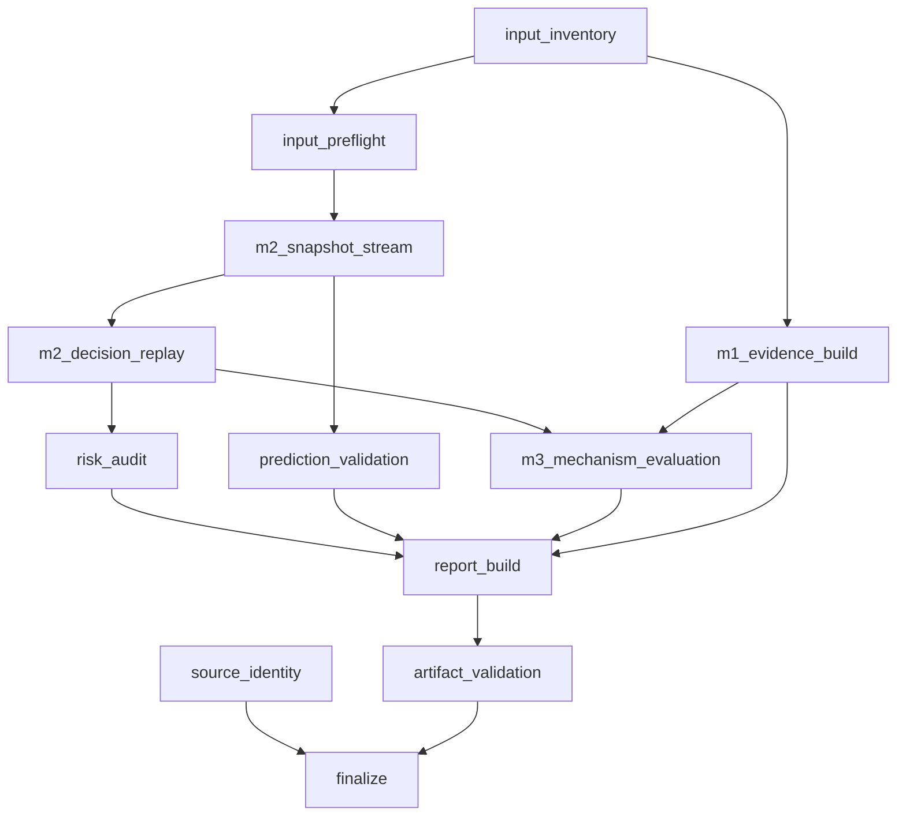

# 数据分析与模拟重建结构重构设计

状态：R1/R2/R3 的可验证第一版已实施；本文件的严格完成条件尚未全部达成。真实服务器资格验证、Analysis 的共享执行器调度、step/M1 的严格有界内存和中断 offset 续跑仍待完成。

实施边界（当前代码事实）：

- Optimizer Harness 已使用共享 `agentmon.pipeline` DAG，阶段 outcome、执行 disposition 与字段质量分离。Analysis 已声明真实业务依赖并将 legacy stage record 镜像为相同 `PipelineStageResult`/`pipeline_manifest.json`；既有业务调度仍在兼容 facade 中，尚未改为由 `PipelineExecutor` 调度。
- Harness 已把原始 `events.jsonl` 改为流式读取，将 P2 service sample 及 replay static timepoint 外部排序为阶段私有分片，并流式写 snapshot、decision、summary、risk audit 和 prediction 输出。`BatchExperimentData` 现有 source-only index / step CSV iterator，M1 完成后 Harness 以 lazy step-row adapter 进入 M2/M3；M1 图和 M3 的少量摘要兼容聚合仍会随输入增长。queue p95 使用阶段私有 SQLite treap 做精确 order statistic；prediction 的 next-future model observation 使用阶段私有 SQLite 有序索引，二者均不启用或替代默认关闭的 `metrics.sqlite3`。`--memory-budget-bytes` 不再有隐式最小值，snapshot manifest 写出单 snapshot/decision group 驻留契约。
- `--resume` 仅复用输入、源码、策略顺序、AgentMon 配置、Schema Profile 和内存预算身份完全一致的**已完成** replay；复用前还会验证所有对外 replay 文件、snapshot manifest 和每个 snapshot part 的 hash。中断中的 partial 分片不发布，当前会从该 replay stage 重跑；尚未实现从 JSONL offset 加载活跃 interval 与 percentile spill state 的精确续跑。小 fixture 已对 materialized compatibility replay 与 streaming replay 的 summary、risk audit、prediction 输出作语义对照。
- 源码包已内置 `.agentmon/source-manifest.json`。full release gate 必须验证 package、安装目录和实际导入根；`scripts/agentmon_optimizer_qualification.py` 启动 Harness 时显式以前述安装根的 `src` 作为首个导入路径，并要求 Harness 的 `packaged_verified` source tree hash 与 full gate 一致。Harness 写出 hash-only `artifact_provenance.json`，仓库单测比较两次独立运行的规范化 M1/M2/M3 产物。真实服务器 historical-data qualification 尚未在本机声明通过。

适用范围：研究线 `load_monitor_optimizer_harness`。稳定冒烟线 `load_monitor` 不在本设计的修改范围内。

## 1. 设计结论

当前实现不是整体不可用，但三个结构问题仍未解决：

1. Analysis Runtime 与 Optimizer Harness 各自维护阶段状态、进度和失败处理，阶段依赖不是可执行的真实 DAG。
2. snapshot、decision、prediction 和 evaluation 以完整列表串联，原始事件读取也会物化全部记录；局部消除平方复杂度后，内存和恢复能力仍随数据规模增长。
3. 源码包、解包目录、Python 实际导入模块和分析产物之间没有强制的不可变身份链，也没有覆盖历史目录形态的包级端到端 golden gate。

本次重构分为三个相互配合、可独立验收的结构项：

- R1：通用阶段状态机与真实 DAG；
- R2：有界内存的流式 snapshot / advice replay / reducer；
- R3：不可变源码身份链与历史数据 golden gate。

不在本次范围内：在线 enforce、指标级性能仿真、因果收益估计、Runtime 核心调度改造，以及任何特定框架、后端、实验路径、任务标识或并发档位的内置逻辑。

## 2. 当前代码事实

### 2.1 可复用部分

- `agentmon.analysis.execution.AnalysisRunContext` 已有原子状态文件、阶段运行时间、RSS、磁盘增长、输入/输出哈希、恢复和缓存检查。
- snapshot 构造已用增量 service sample 游标替代逐时间点扫描全部 service sample，局部平方复杂度已经消除。
- optimizer preflight 能拒绝完全没有时间证据的输入，并保留 `PARTIAL` / `UNRESOLVED`。
- risk audit、strategy summary、conflict audit、ablation 和 contribution 的计算本质上都是有限状态归约。
- 发布门禁已经能比较包内已有文件与安装目录中的对应文件。

### 2.2 仍需结构重构的部分

- Analysis 的 DAG 边已由业务依赖声明，但兼容 facade 仍按既有顺序调度，尚未成为共享 executor 的可并行 stage function 集。
- Optimizer Harness 不再维护独立 `HarnessProgress`；它仍只复用完整 replay，不支持中断 offset 续跑。
- M1 compatibility adapter 仍可保存完整 step row，evidence graph 与部分 M3 摘要也会随输入增长；但 Harness 在 M1 完成后切换为 source-only step CSV iterator，M2 不再保留该兼容列表。`build_snapshot_timeline` 仍是仅供迁移对照的 materialized adapter，默认 Harness 不调用它。
- model interval compatibility index 和 M1/M3 的部分聚合仍可能保存与输入规模同阶的数据；queue percentile、时间点去重和未来 observation 排序已改为阶段私有磁盘结构。
- package 已有自描述逐文件摘要清单，正式安装校验会拒绝受管目录的修改、缺失和额外文件，并检查实际导入根。
- `eligible_for_server_preflight` 已与 full gate 的 package/installed/import identity 检查绑定；这不替代对真实历史数据运行 qualification。

## 3. R1：通用阶段状态机与真实 DAG

### 3.1 模块边界

新增与具体分析域无关的执行内核：

```text
src/agentmon/pipeline/
  model.py       # StageSpec、StageResult、ArtifactRef、状态枚举
  executor.py    # DAG 调度、阻断、恢复、缓存和超时
  journal.py     # 原子状态、checkpoint、运行摘要
  hashing.py     # 输入、配置、代码和产物身份
```

`agentmon.analysis` 和 `agentmon.optimizer.harness` 分别声明自己的阶段目录，不互相导入业务实现。现有 `AnalysisRunContext` 的通用能力迁入该内核，Analysis 保留兼容 facade。Optimizer Harness 删除独立的 `HarnessProgress`，改用同一执行内核。

不把 optimizer 的所有子阶段追加到全局 Analysis 阶段列表。`analysis run-all` 只把 optimizer harness 当作嵌套 pipeline，并记录其子 manifest。

### 3.2 状态语义

阶段结果与执行方式必须分离：

```text
StageOutcome:
  COMPLETE    输出契约完整满足
  PARTIAL     有可用输出，但证据或字段不完整
  UNRESOLVED  存在歧义，无法得到唯一合法解释
  FAILED      软件、I/O、资源或契约执行失败
  SKIPPED     因策略、范围或上游能力缺失而未执行

ExecutionDisposition:
  EXECUTED
  CACHED
  RESUMED
```

`CACHED` 不再伪装成数据质量。字段级缺失继续使用 `UNKNOWN`；它不是阶段执行状态。

结论类型也独立于阶段状态：

```text
ClaimClass:
  OBSERVED     权威输入中直接观测到的字段或事件
  DERIVED      可由已声明公式、聚合或时间关联确定性重算的结果
  INFERRED     依赖规则、归因假设或 optimizer 策略的解释
  UNRESOLVED   证据缺失或冲突，无法形成唯一结论
```

`DERIVED` 必须记录 derivation rule；`INFERRED` 必须记录 assumptions、limitations 和
forbidden conclusions。`COMPLETE` 只表示阶段输出契约完整，不能把 `INFERRED` 提升为事实。

每个 `StageResult` 至少包含：

```text
outcome
reason_codes
provided_capabilities
missing_capabilities
artifacts[path, schema, sha256, row_count]
evidence_sources
data_quality
limitations
forbidden_conclusions
checkpoint
resource_usage
source_identity
```

仅凭 `PARTIAL` 不能决定是否继续。阶段通过 capability contract 表达真实阻断条件，例如：

- `timeline_order_resolved`
- `nonempty_snapshot_stream`
- `strategy_set_resolved`
- `evidence_pack_available`
- `decision_stream_complete`

这能区分“缺少可选 P2，但仍可按 run/step 时间线回放”和“时间顺序有歧义，不能回放”两种同为 `PARTIAL` 或 `UNRESOLVED` 的情况。

### 3.3 Optimizer Pipeline DAG



图中的边是依赖，不是展示顺序。DAG 文件由 `StageSpec.dependencies` 生成，不再用相邻阶段推导。

### 3.4 阻断规则

| 条件 | M1 Evidence | Snapshot | Replay | M3 | Final report |
|---|---|---|---|---|---|
| batch 目录不存在 | `UNRESOLVED` | `SKIPPED` | `SKIPPED` | `SKIPPED` | 输出失败说明 |
| 没有任何可观测时间点 | 可输出缺失证据 | `UNRESOLVED` | `SKIPPED` | `SKIPPED` | 输出限制说明 |
| P2 缺失但 run/step 时间线合法 | `PARTIAL` | `PARTIAL` | 可执行，字段保持 `UNKNOWN` | proxy-only | `PARTIAL` |
| 同一 service/time/field 冲突 | 保留冲突事实 | 冲突字段 `UNKNOWN` | 可执行但降质 | proxy-only | `PARTIAL` |
| run 定位有多个候选且影响时间线 | 保留候选 | `UNRESOLVED` | `SKIPPED` | `SKIPPED` | 输出阻断原因 |
| snapshot 为空 | 不补零时刻 | `UNRESOLVED` | `SKIPPED` | `SKIPPED` | 输出阻断原因 |
| 进程中断 | 已完成阶段保持可复用 | 当前阶段 `FAILED` | 不发布半成品 | 不执行 | 可在恢复后生成 |

### 3.5 产物目录

```text
<output>/
  pipeline_manifest.json
  pipeline_status.json
  source_identity.json
  stages/
    <stage>/
      stage_status.json
      artifact_manifest.json
      checkpoint.json
      parts/
  ...现有 M1/M2/M3 对外产物...
```

阶段 part 先写临时或不可变分片，只有 artifact manifest 校验通过后才发布最终文件。恢复时同时校验输入身份、配置哈希、schema/profile 哈希、代码身份和已完成分片哈希。

## 4. R2：有界内存流式 Replay

### 4.1 目标约束

内存不得与原始 event、snapshot 或 decision 总数线性增长。允许内存随以下真实在线状态增长：

- 输入流数量；
- 当前活跃 run / model interval；
- 策略数量；
- 已声明 reducer key 数量；
- 显式配置的内存预算。

超过预算的数据必须 spill 到阶段私有临时存储。该存储是可重建派生物，不是权威数据，也不启用或替代默认关闭的 `metrics.sqlite3`。所有来源仍追溯到 `events.jsonl`、batch 文件和 step CSV。

### 4.2 输入层

将 `BatchExperimentData` 拆为轻量索引与迭代器：

```text
BatchExperimentIndex
  batch metadata
  batch result source
  step CSV sources
  run_id -> events.jsonl source resolution
  source quality and hashes

iter_batch_results()
iter_step_rows()
iter_run_events()
```

读取 JSONL 时只保留当前记录和错误计数。每个事件记录携带来源文件、字节偏移或行号。无效行进入质量统计，不被悄悄修复。

### 4.3 时间归一化与排序

当前 `sorted(set(all_timepoints))` 改为外部排序流：

1. 从 run interval、step boundary 和 P2 sample 生成规范化 timestamp record；
2. 每个内存 chunk 内排序并写不可变 part；
3. 用 heap 做多路归并和去重；
4. 输入若已验证单调，可直接进入归并；若不单调，记录 normalization limitation 后走外部排序；
5. timestamp 缺失或跨时钟域不可比时保持 `UNRESOLVED`，不猜测偏移。

同一 service/time/field 的重复相同值可去重；冲突值记录 conflict evidence，并令对应 snapshot 字段为 `UNKNOWN`。

### 4.4 Snapshot 流

`iter_optimizer_snapshots(...)` 每次只产生一个 snapshot：

- run start/end 更新 active run map；
- model start/end 更新 active model state；
- service sample 用单向游标更新 latest observed state；
- snapshot 写入 `stages/m2_snapshot_stream/parts/*.jsonl`；
- 下游通过 artifact manifest 顺序读取，不接收完整 list。

精确 percentile 使用可 spill 的 order-statistic backend。小规模状态可留在内存，超过预算后使用阶段私有的磁盘索引；若用户显式选择近似算法，输出必须标为 `PARTIAL` 并记录算法、误差语义和禁止结论，绝不能把近似值标成观测精确值。

### 4.5 Decision 与在线 reducer

每个 snapshot 到达后，策略实例只构造一次并按固定策略顺序执行。decision 立即写分片，同时更新 reducer：

- strategy summary：pressure、would-defer、would-limit、would-relax 和 risk flag 计数；
- risk audit：上一压力、最近两条压力、转换计数、A-B-A 检测、当前/最长连续计数；
- conflict audit：只保留当前 snapshot 的各策略 decision；
- ablation：每策略固定计数器；
- contribution：`(strategy, component)` 计数器；
- prediction：阶段私有 SQLite future-observation 有序索引和在线 covariance accumulator。

Pearson 相关不保存 pair list，使用稳定的在线协方差状态。`next_future_model_request` 继续采用 `start_mono_ns >= snapshot_time` 的现有语义，并写入 schema contract。

冲突明细和其他可能很大的 JSON 数组采用流式 JSON writer 或先写 JSONL part，再在 finalize 阶段顺序组装，不能先收集到 Python list。

### 4.6 恢复与确定性

推荐使用不可变分片，而不是对半写 JSONL 猜测截断位置：

```text
part-000000.jsonl
part-000001.jsonl
...
checkpoint.json
```

checkpoint 记录：

- 输入 source identity 和已消费 offset；
- 最后完成的 timestamp / snapshot index；
- part 文件哈希与行数；
- reducer 状态及其 schema version；
- 策略/profile/config/code 哈希。

恢复只从最后一个完整 part 继续。输入变化、配置变化、策略实现变化或 part 哈希不匹配时，当前阶段缓存失效。完整重跑与中断恢复后的规范化输出哈希必须一致。

现有对外文件名保持不变。内部 snapshot 流单独存一次；兼容版 `optimizer_decisions.jsonl` 可在 finalize 时顺序展开完整 snapshot，避免要求现有消费者立刻升级，同时仍保持有界内存。

## 5. R3：不可变源码身份链与 Golden Gate

### 5.1 包内源码清单

源码包新增内置清单，例如：

```text
.agentmon/source-manifest.json
```

清单包含：

- schema version 和 manifest type；
- 受管路径与排除规则版本；
- 每个源码文件的相对路径、size、sha256；
- 对规范化文件条目计算的 `source_tree_sha256`；
- build tool version；
- 可选 git 信息，仅作补充证据，不作为唯一身份。

包压缩字节的 SHA256 继续放在外部 receipt 中。包内清单标识源码树，外部 receipt 标识具体 tar 字节，避免循环哈希问题。

### 5.2 安装与导入验证

正式服务器 gate 必须同时满足：

1. tar SHA256 与 receipt 一致；
2. tar 安全、干净且内置 source manifest 有效；
3. 安装目录中受管文件无缺失、无修改、无未允许的额外源码文件；
4. gate 使用的 Python 实际导入 `agentmon` 及关键模块都位于该安装根；
5. 导入文件摘要与 source manifest 一致；
6. quick/full gate 与分析产物记录同一个 `source_tree_sha256`。

本地开发目录允许生成 `working_tree_unsealed` 身份，但不得设置 `eligible_for_server_preflight=true`。正式 gate 若未提供或未验证安装目录，应明确为 `NOT_VERIFIED`，不能仅因包内测试通过就取得服务器资格。

每个 pipeline manifest 和最终报告都记录：

```text
source_tree_sha256
package_sha256       # 可无；无时为 UNKNOWN
source_identity_mode # packaged_verified / working_tree_unsealed
gate_manifest_sha256 # 可无；无时为 UNKNOWN
```

### 5.3 历史数据 Golden Gate

测试分三层：

1. **单元层**：状态阻断、流式 reducer、冲突字段、恢复、身份校验和变更拒绝。
2. **仓库集成层**：由 fixture builder 生成不含真实任务信息的历史目录形态，包括分散 run root、集中 run root、失效绝对路径、显式搜索根、缺失 P2、重复/冲突 sample 和部分损坏 JSONL。
3. **服务器资格层**：从干净 tar 解包，在目标 Python 环境验证身份后，对真实保留实验目录执行 preflight 和完整 pipeline，生成独立 qualification manifest；真实路径和观测值只进入该次运行产物，不进入通用代码或测试判断。

Golden 比较时先移除生成时间、绝对根路径和运行时资源统计等非语义字段，再比较规范化 JSON/CSV 哈希。必须覆盖：

- 同一输入连续运行结果一致；
- 中断恢复与干净重跑结果一致；
- materialized 兼容实现与 streaming 实现在小 fixture 上语义一致；
- 缺失数据仍为 `UNKNOWN` / `PARTIAL` / `UNRESOLVED`；
- 不出现零时刻伪 snapshot；
- Prompt、摘要正文、原始工具输出和完整代码 diff 不进入输出；
- API first output、EngineCore first token、总 Prompt Tokens 和实际 Prefill Tokens 不发生语义替换；
- 修改、删除或额外加入受管源码文件都会使正式身份 gate 失败。

性能 gate 不把某个固定事件数或墙钟阈值写进通用逻辑。确定性测试通过内部统计断言“最大驻留 snapshot 数、decision group 数和 reader buffer 不随总记录数增长”；服务器 benchmark 只记录实测曲线和环境，不把经验值冒充普遍阈值。

## 6. 实施顺序

### Phase 0：行为冻结

- 为当前小规模 M1/M2/M3 输出建立规范化 golden。
- 增加 claim class：`OBSERVED`、`DERIVED`、`INFERRED`、`UNRESOLVED`。
- 记录当前 schema 和兼容字段，避免重构时悄悄改变含义。

### Phase 1：抽取通用阶段内核

- 从 Analysis Runtime 提取通用执行、journal、hash 和 cache 能力。
- Analysis 先接回兼容 facade，确认现有 Analysis 测试不变。
- Optimizer Harness 声明真实 DAG，替换 `HarnessProgress`。
- 增加阶段阻断、缓存失效和中断恢复单元测试。

### Phase 2：流式数据路径

- 引入轻量 input index 和 iterator；先保留 materialized compatibility adapter。
- 实现 timestamp 外部归并、snapshot 分片和在线 reducer。
- 在小 fixture 上双跑并比较规范化输出。
- streaming 稳定后设为默认；兼容 adapter 保留一个迁移周期。

### Phase 3：源码身份链

- 包内生成 source manifest；release gate 强制验证安装根和实际导入根。
- 把 source identity 传播到阶段和最终产物。
- 正式服务器资格与 installed-source 验证绑定。

### Phase 4：Golden 与服务器资格

- 跑仓库集成 golden、干净包 gate 和中断恢复测试。
- 在服务器目标环境对保留历史数据运行 preflight，再运行完整 pipeline。
- 只有 qualification manifest 为通过，才将该版本标为“可用于服务器历史数据分析”；本机单元测试通过不等同于服务器资格。

## 7. 验收标准

### 7.1 当前验收账本

| 项 | 当前状态 | 已验证事实 | 未完成项 |
|---|---|---|---|
| R1 | `PARTIAL` | Optimizer 使用共享 DAG；M3、报告和 provenance 按真实依赖顺序执行；失败可被诊断报告显式接收且顶层保持 `FAILED`；Analysis 复用 `StageSpec` 与 `PipelineStageResult` 输出契约。 | 将 Analysis 业务阶段拆为由 `PipelineExecutor` 调度的函数，并迁移 capability 级缓存。 |
| R2 | `PARTIAL` | 原始 P2 流、snapshot、decision、risk audit 和 prediction reducer 均不再完整物化；Harness 在 M1 后改用 lazy step CSV iterator；prediction future observation 使用磁盘有序索引；queue p95 使用阶段私有精确 SQLite treap；预算无隐式下限；单次运行 Golden 一致；小 fixture 的 materialized compatibility replay 与 streaming replay 输出一致。 | M1 图和 M3 摘要兼容聚合；model interval 索引；中断 offset/reducer 状态续跑。 |
| R3 | `PARTIAL` | source manifest、import/root gate、包含 M3 的 hash-only artifact provenance、仓库 Golden 和服务器 qualification 命令已存在；损坏或配置不兼容的 replay 不可复用。 | 干净包在目标 Python 的 full gate，以及真实保留历史目录 qualification。 |

`PARTIAL` 是实施进度，不是数据质量。任何未完成项均不得在报告中写成已验证的服务器事实。

R1 完成条件：

- Analysis 与 Optimizer 共用一个执行内核；
- DAG 边来自真实依赖声明；
- outcome、execution disposition 和 field data quality 不混用；
- 所有跳过都有机器可读 reason code；
- `PARTIAL` 是否继续由 capability contract 决定。

R2 完成条件：

- 原始 event、snapshot、decision 和 prediction pair 不再完整物化；
- full run 与 resume run 的规范化输出哈希一致；
- 小 fixture 与旧实现语义一致，差异必须有显式 schema migration；
- 内部资源统计证明缓冲区受预算约束；
- 缺失或冲突数据不被补值。

R3 完成条件：

- 包内存在可独立验证的 source manifest；
- 正式 gate 能拒绝源码修改、缺失、额外受管文件和导入根漂移；
- 每个分析产物可回溯到 source tree、输入文件和配置/profile 身份；
- 干净包端到端 golden 通过；
- 服务器历史数据 qualification 通过后才声明正式可用。

## 8. 风险与控制

- **流式重构改变输出顺序**：先定义稳定排序键，并对规范化产物做双实现对照。
- **断点状态与策略内部状态不一致**：策略实例状态必须可序列化；不可序列化策略只能从当前 stage 重跑。
- **磁盘 spill 空间不足**：preflight 只基于输入规模给出估算和可用空间事实，不使用硬编码经验门限；写入失败必须 `FAILED`。
- **压缩 JSONL 无法按字节续读**：当前 stage 从头重建，不能声称 append resume。
- **旧消费者依赖嵌套 snapshot JSONL**：finalize 阶段提供流式兼容导出，canonical 内部格式不重复 snapshot。
- **近似统计被误认为事实**：近似模式必须显式 opt-in，并标 `PARTIAL`、算法和限制；默认优先保持现有精确语义。

## 9. 工作量判断

这不是继续修几个函数即可完成的改动。按一个熟悉项目的工程师估算：

- R1 通用阶段内核与迁移：约 3-5 个工程日；
- R2 流式输入、snapshot、reducer、恢复和兼容输出：约 7-12 个工程日；
- R3 源码身份、golden、包级和服务器资格门禁：约 4-7 个工程日。

合计约 14-24 个工程日，包含确定性单元测试和本地包级集成测试，不包含服务器排队、真实环境故障排查和额外的指标级模拟能力。
