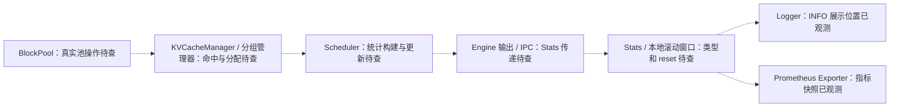

# 指标到 KV 的源码路径与证据边界

## 目前确实可核查的路径

| 来源 | 路径/行号 | 已证明什么 |
|---|---|---|
| USER_PROVIDED_OUTPUT | `/vllm-workspace/vllm/vllm/v1/metrics/loggers.py:290` | 用户 grep 找到 Prefix cache hit rate 格式串；未提供函数体 |
| USER_PROVIDED_OUTPUT | 日志中的 `[loggers.py:310]` | 实际 INFO 输出位置；不是 Scheduler 或 BlockPool 的事件位置 |
| LOCAL_SOURCE | `agentmon/src/agentmon/sampling/vllm_metrics.py:25`、`:63` | `VllmMetricsSampler.sample → fetch_metrics → HTTP GET → parse_prometheus_text → sink.emit`，服务级采样 |
| LOCAL_SOURCE | `agentmon/src/agentmon/analysis/prometheus.py:24` | 原解析器读取 samples 和 labels，不生成请求/Block 身份 |
| LOCAL_SOURCE | `agentmon/src/agentmon/adapters/inference/vllm_018/hook.py:1717`、`:1781` | 旧 Hook 的 observe_scheduler_stats → observe_prefix_cache_stats；这是观察已有 Stats，不是目标源码的指标生产者 |
| LOCAL_SOURCE | 同一旧 Hook `:954`、`:979`、`:1039`、`:1071` | lookup/allocate/free/evict 包装逻辑；版本 0.18，仅供参考 |
| LOCAL_SOURCE | `agentmon/src/agentmon/adapters/inference/vllm_018/events.py:423` | 当前 kv_block_event 有数量字段，没有真实 Block identity/refcount/allocation generation |

## 目标 0.27.1 待核查图（不是已验证调用图）

虚线全部表示 UNRESOLVED 的数据传播关系。方法名相同不能证明运行对象相同；Logger/Exporter 还可能使用不同累积窗口。真实事件从分配与池操作产生，日志仅是展示出口。

## 每个指标必须回答的源码问题

| 指标/出口 | 起点 | 追踪至真正生产点的检查 |
|---|---|---|
| INFO Prefix hit rate | loggers.py 格式串所在方法 | 分子/分母、窗口累积容器、日志周期重置；向上找 Stats 字段生产者 |
| queries_total / hits_total | exporter Counter 定义与 inc | 增量来自 token 数、block 数还是操作次数；Stats 是增量/累计；cache reset 是否影响它 |
| usage gauge | exporter set / logger percent 格式化 | 传入 usage 值如何计算，分母与 free/reusable pool 定义；空闲缓存是否计入 |
| preemptions_total | Counter inc | Scheduler 的哪条 preemption 分支修改 Stats；覆盖范围与 exporter 重启 |
| cache_config_info | Info 注册/更新 | 实际配置对象、赋值时序、group 口径以及容量公式 |

候选源码：`v1/metrics/{loggers,stats}.py`、`v1/core/sched/scheduler.py`、`v1/core/{kv_cache_manager,block_pool,kv_cache_utils,kv_cache_coordinator,single_type_kv_cache_manager}.py`、`v1/kv_cache_interface.py`、`v1/engine/{core,__init__}.py`、`config/cache.py`，以及 Ascend 的配置/attention/backend 引用。当前不能声称这些候选全存在于目标版本。

新增 `dsv41_kv_source_snapshot.py` 只读 AST：保存候选文件完整源码、真实定义行号、包含方法上下文的词法调用、统计/配置相关引用和包 metadata/Git HEAD；未知文件明确 MISSING。render 输出 `source_inventory.md`。词法 `self.x.foo()` 标记 UNRESOLVED dispatch，需要用初始化/赋值和实际类型闭环。它不会导入 vLLM、安装 Hook，也不会把采集成功升级成调用链 PASS。

当前真实生产函数与 counter 单位仍 UNRESOLVED。需要服务器只读 snapshot 返回后，才能给出完整真实方法链/行号及实现解释。
